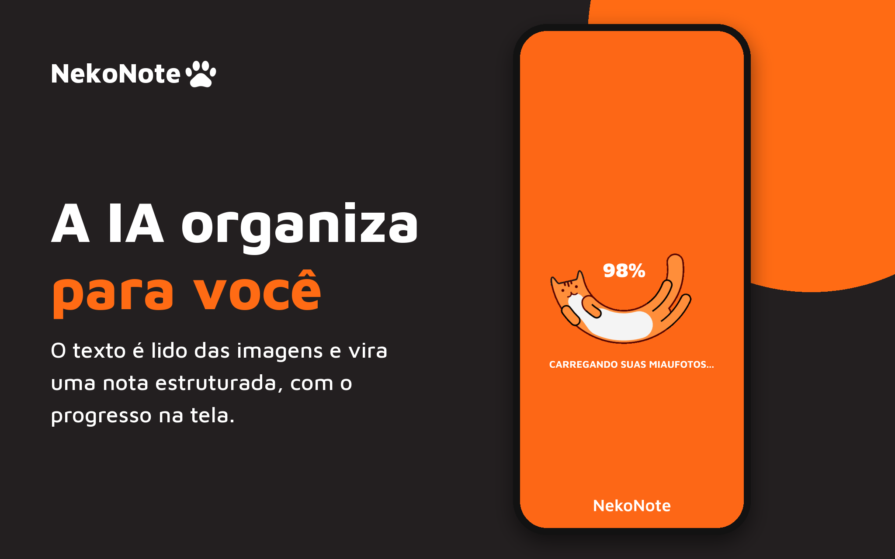

<div align="center">


# NekoNote

### Tire foto. Vire nota.


</div>

---

## O que é

O NekoNote é um app Android que transforma foto de página de livro, caderno ou slide em uma nota no Notion. Você tira as fotos (até 20 de uma vez), o servidor lê o texto delas, uma IA organiza esse texto em resumo, assuntos e tópicos e a página já aparece pronta no Notion de quem usou.

Eu fiz isso porque estudo muito por apostila e slide e sempre acabava com um monte de foto perdida na galeria, e depois tinha que digitar tudo de novo pra passar pro Notion.

## Como funciona

1. Entra com a conta do Google (o login é pelo Supabase Auth, não tem senha)
2. Conecta o Notion, toca em autorizar e escolhe quais páginas o app pode usar
3. Tira as fotos ou escolhe da galeria, até 20 por envio. Antes de mandar o app já avisa se alguma foto está com pouco texto (ML Kit)
4. Escolhe o que quer na nota (resumo, assuntos, tópicos), a página de destino e o tom da escrita
5. A API faz o OCR, a IA escreve e a página aparece no Notion, com o progresso na tela enquanto isso

## Telas

<table>
  <tr>
    <td width="50%" align="center">
      
      <br /><sub>Fotografar ou escolher da galeria</sub>
    </td>
    <td width="50%" align="center">
      
      <br /><sub>Conectar o Notion</sub>
    </td>
  </tr>
  <tr>
    <td width="50%" align="center">
      
      <br /><sub>Escolher o formato da nota</sub>
    </td>
    <td width="50%" align="center">
      
      <br /><sub>Processando as fotos</sub>
    </td>
  </tr>
</table>

## Arquitetura

<div align="center">
  
</div>

O app não guarda nenhuma chave (OpenAI, Notion), por isso existe a API no meio. Ela guarda os segredos e faz o trabalho pesado. O OCR oficial é o Tesseract no servidor, assim o texto sai igual em qualquer celular. O ML Kit no app serve só pra dar aquela prévia rápida. O progresso chega pelo WebSocket porque o processamento demora e não queria o app perguntando toda hora.

O login e os tokens do Notion ficam num Supabase que roda no próprio Docker, e a API é exposta com um túnel da Cloudflare, sem abrir porta no servidor.

## Tecnologias

- App: Kotlin, Jetpack Compose, CameraX, ML Kit, Credential Manager, OkHttp e Coil (minSdk 26)
- API: Python 3.13, FastAPI, Uvicorn, httpx, Pillow, pytesseract e cryptography
- Login e dados: Supabase auto-hospedado (Postgres, GoTrue e PostgREST)
- IA: OpenAI com structured outputs, o modelo padrão é o `gpt-4.1-mini` e dá pra trocar em `OPENAI_MODEL`
- Infra: Docker Compose e Cloudflare Tunnel

## Estrutura

```text
nekonote/
├── mobile/              app Android
│   └── app/src/main/java/.../nekonote/
│       ├── dados/       modelos, auth, cliente REST, fotos, WebSocket
│       └── visual/      telas, componentes e tema
├── api/                 servidor FastAPI
│   ├── main.py
│   ├── docker-compose.yml   API + Supabase + túnel Cloudflare
│   ├── .env.example
│   ├── supabase/            SQL da tabela usuarios e gerador de chaves
│   ├── src/                 ocr, ia, notion, protecao, conta, notas...
│   └── tests/
└── assets/              imagens deste README
```

## Como rodar

### API

```bash
cd api
python -m venv .venv && .venv/bin/pip install -r requirements-dev.txt   # no Windows é .venv/Scripts/pip
cp .env.example .env                                                    # preenche as variáveis
.venv/bin/python main.py                                                # sobe em http://localhost:8000
.venv/bin/python -m pytest                                              # testes
```

Pra produção é só `docker compose up -d --build`, que sobe a API, o Supabase e o túnel. A imagem já vem com o Tesseract e o idioma português.

Se faltar alguma variável obrigatória o servidor sobe mesmo assim, só `/`, `/privacidade`, `/termos` e `/saude` funcionam e o resto responde 503. Isso ajuda na hora de registrar a integração no Notion, que pede essas páginas no ar.

O que precisa configurar no `.env`:

1. **Domínio**: `API_DOMAIN` com o endereço público da API (ex: `api.exemplo.com.br`). É a única config de endereço, dela saem o redirect do Notion, a URL do login e os hosts aceitos
2. **Supabase**: `python supabase/gerar_chaves.py` gera `POSTGRES_PASSWORD`, `JWT_SECRET` e as chaves `SUPABASE_*`. A tabela `usuarios` é criada sozinha na primeira subida
3. **Google**: `GOOGLE_CLIENT_ID` com o ID do cliente OAuth Web do Google Cloud, e a redirect URI `https://<API_DOMAIN>/auth/v1/callback`
4. **Notion**: cria uma integração pública em notion.so/profile/integrations, com redirect `https://<API_DOMAIN>/notion/callback`, política de privacidade em `/privacidade` e termos em `/termos`. Permissões de ler e inserir conteúdo. O `client_id` e o `client_secret` vão em `NOTION_CLIENT_ID` e `NOTION_CLIENT_SECRET`
5. **Segredos**: `ENCRYPTION_KEY` e `STATE_SECRET`, os comandos pra gerar estão no `.env.example`. Se perder a `ENCRYPTION_KEY` os tokens do Notion salvos deixam de funcionar
6. **OpenAI**: `OPENAI_API_KEY`. Vale colocar um limite de gasto mensal no painel

### App

Precisa do Android Studio (ou JDK 17+ e Android SDK 37) e um celular com depuração USB.

```bash
cd mobile
cp local.properties.example local.properties   # ajusta o sdk.dir e preenche as duas linhas abaixo
./gradlew :app:assembleDebug                   # gera o app-debug.apk
./gradlew :app:installDebug                    # instala no celular ligado por USB
```

```properties
nekonote.dominio=api.exemplo.com.br            # o mesmo API_DOMAIN do .env da api
google.idClienteWeb=<ID do cliente OAuth Web do Google Cloud>
```

No Google Cloud também precisa do cliente Android, com o pacote do app (o `applicationId` do `build.gradle.kts`) e o SHA-1. O `./gradlew :app:signingReport` mostra o do build de debug. O ID do cliente Web tem que ser o mesmo do `GOOGLE_CLIENT_ID` da API.

## Rotas da API

Tudo exige `Authorization: Bearer <token do Supabase Auth>`, menos as rotas públicas.

| Método | Rota | O que faz |
|---|---|---|
| GET | `/conta` | e-mail, id público e estado da conexão com o Notion (nunca devolve token) |
| DELETE | `/conta` | apaga os tokens do Notion e a conta de login |
| POST | `/notion/conectar` | devolve a URL de autorização do Notion |
| GET | `/notion/callback` | pública, troca o code e devolve o usuário pro app via `nekonote://notion` |
| GET | `/notion/paginas` | páginas que o usuário liberou |
| DELETE | `/notion/conexao` | desconecta o Notion |
| GET | `/notas` | notas criadas pelo app, as mais recentes primeiro |
| WS | `/ws/ocr` | processamento das fotos |
| GET | `/`, `/privacidade`, `/termos`, `/saude` | públicas |

O WebSocket recebe um pedido assim:

```json
{
  "acao": "processar",
  "id_pedido": "a1b2c3d4e5",
  "id_pagina": "<id da página no Notion>",
  "modalidades": { "topicos": true, "resumo": true, "assunto": false },
  "temperamento": "equilibrado",
  "imagens": ["<base64>", "..."]
}
```

e responde com os eventos `inicio`, `progresso`, `enviando`, `criando` e no fim `resultado` (com a `url_pagina`) ou `erro`.

O `id_pedido` é escolhido pelo app. Se a conexão cair no meio, o app reconecta com o mesmo id e continua a mesma tarefa, sem gastar IA de novo nem criar a página duas vezes.

Os erros sempre vêm no mesmo formato, com `codigo` (fixo, é o que o app usa), `mensagem` (pro usuário) e `request_id` (pra achar no log):

```json
{"codigo": "LIMITE_EXCEDIDO", "mensagem": "Muitas requisições. Tente de novo em instantes.", "request_id": "9f1c..."}
```

Limites: 1 a 20 imagens por pedido (até 8 MB cada) e 10 processamentos por hora por usuário.

## Segurança e privacidade

- Foto e texto não são guardados. Só existem na memória enquanto processa, o resultado fica só no Notion do usuário e os logs não têm conteúdo
- Os tokens do Notion ficam cifrados (Fernet) no banco e nunca vão pro app
- O `state` do OAuth é assinado e expira
- Toda rota nova já nasce protegida, só passa sem token o que está listado em `protecao/rotas_publicas.py`
- Tem limite de requisições por IP e por usuário, e o IP é bloqueado por um tempo se errar o token várias vezes
- O texto que vem das fotos é tratado como dado, não como instrução pra IA, e a resposta dela é validada contra um esquema antes de ser usada
- O container roda sem privilégio, com o sistema de arquivos só leitura, e a API só é acessada pelo túnel (fica em `127.0.0.1`)
- Não tem CORS nem `/docs`, o único cliente é o app

Antes de publicar vale conferir: segredos aleatórios com 32+ caracteres, a porta 8000 fechada no firewall, o limite de gasto na OpenAI e rodar `pip-audit` nas dependências.

## Limitações

- Lê só texto impresso em português, manuscrito e outros idiomas não funcionam direito
- Só Android, não tem iOS nem versão web
- Sem Play Store, o APK de debug usa a chave de debug, pra distribuir de verdade precisa criar uma chave própria
- Trabalha com páginas do Notion, não com databases
- Precisa do servidor, então não funciona offline

---

<div align="center">

Feito por **Roger Leonel**

</div>
