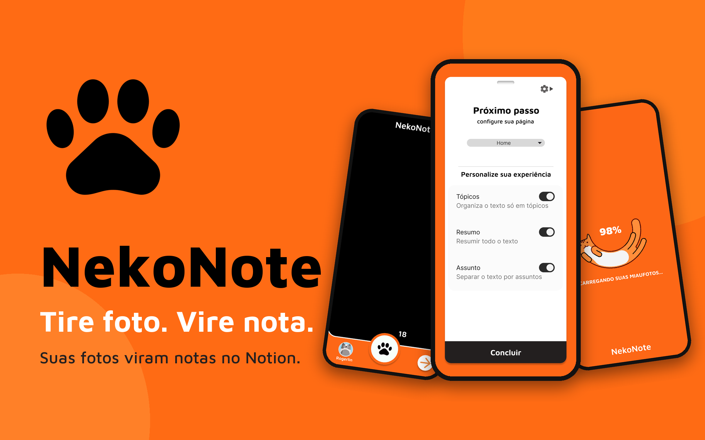
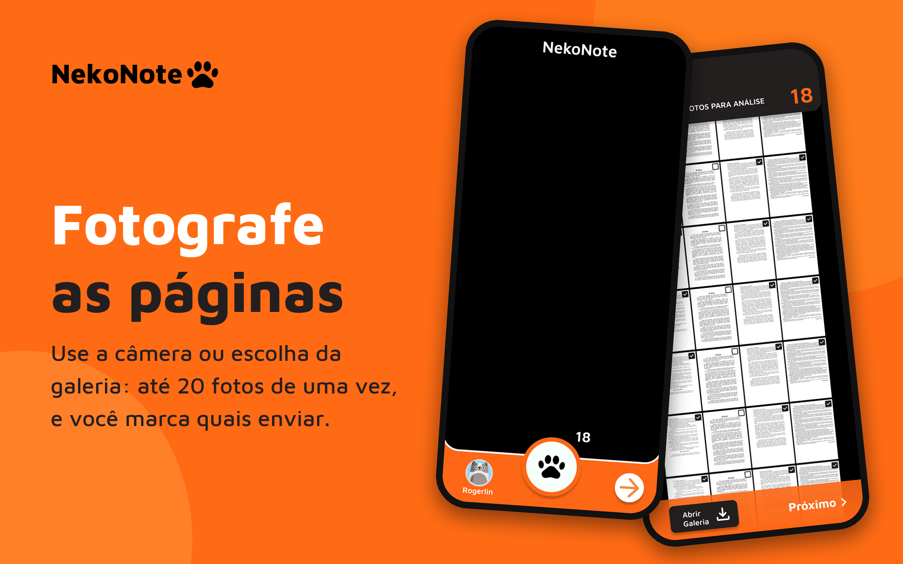
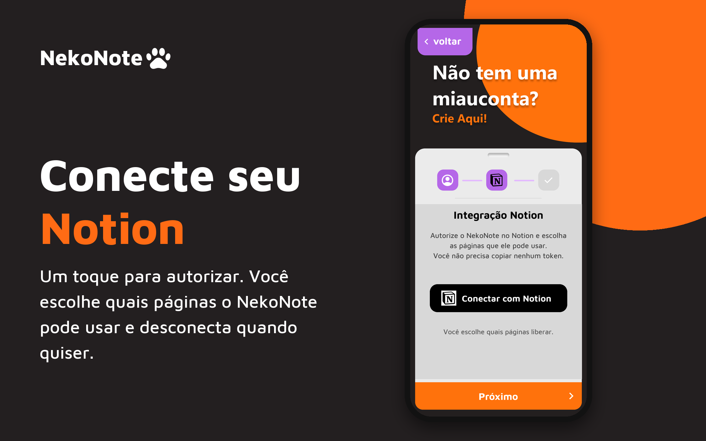
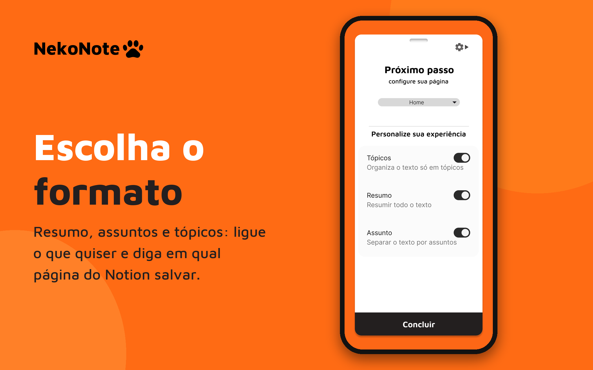
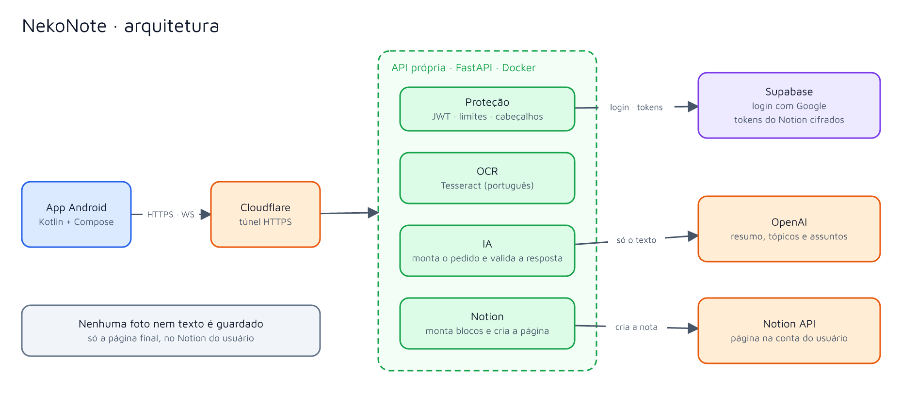

<div align="center">


# NekoNote

### Tire foto. Vire nota.

**Fotografe páginas de livros, cadernos e slides e receba uma nota organizada no seu Notion, com resumo, assuntos e tópicos.**

<br />


<br />



</div>

---

## Sumário

- [O que é](#o-que-é)
- [Como funciona](#como-funciona)
- [Galeria](#galeria)
- [Funcionalidades](#funcionalidades)
- [Arquitetura](#arquitetura)
- [Stack](#stack)
- [Estrutura do repositório](#estrutura-do-repositório)
- [Como rodar](#como-rodar)
- [API em resumo](#api-em-resumo)
- [Segurança e privacidade](#segurança-e-privacidade)
- [Limitações conhecidas](#limitações-conhecidas)
- [Documentação detalhada](#documentação-detalhada)

---

## O que é

Quem estuda a partir de livros, apostilas e slides costuma acabar com dezenas de fotos perdidas na galeria, e quem usa Notion ainda precisa **digitar tudo** para reorganizar o conteúdo.

O **NekoNote** resolve isso: um app Android que recebe até **20 fotos de uma vez**, lê o texto delas (OCR), pede a uma IA que organize o conteúdo e **cria uma página pronta no Notion do próprio usuário**.

## Como funciona

| | Passo | O que acontece |
|:-:|---|---|
| 1️⃣ | **Entre com o Google** | Login via Supabase Auth, sem senhas. |
| 2️⃣ | **Conecte o Notion** | Um toque para autorizar (OAuth). Você escolhe quais páginas o app pode usar e nunca copia token nenhum. |
| 3️⃣ | **Fotografe ou escolha da galeria** | Até 20 fotos por envio, com prévia de legibilidade no próprio aparelho (ML Kit). |
| 4️⃣ | **Escolha o formato** | Resumo, assuntos e/ou tópicos, a página de destino e o tom da escrita. |
| 5️⃣ | **A mágica acontece** | A API faz o OCR, a IA escreve a nota e a página aparece no seu Notion, com o progresso em tempo real na tela. |

## Galeria

<table>
  <tr>
    <td width="50%" align="center">
      
      <br /><sub><b>Fotografe as páginas</b><br />Câmera ou galeria: até 20 fotos de uma vez, e você marca quais enviar.</sub>
    </td>
    <td width="50%" align="center">
      
      <br /><sub><b>Conecte seu Notion</b><br />Um toque para autorizar. Você escolhe as páginas e desconecta quando quiser.</sub>
    </td>
  </tr>
  <tr>
    <td width="50%" align="center">
      
      <br /><sub><b>Escolha o formato</b><br />Resumo, assuntos e tópicos: ligue o que quiser e diga em qual página salvar.</sub>
    </td>
    <td width="50%" align="center">
      
      <br /><sub><b>A IA organiza para você</b><br />O texto é lido das imagens e vira uma nota estruturada, com o progresso na tela.</sub>
    </td>
  </tr>
</table>

## Funcionalidades

### 📱 App Android

- **Captura em lote** com CameraX ou seleção pela galeria (Photo Picker, sem permissão de armazenamento), limitada a 20 fotos por envio.
- **Prévia de legibilidade** no aparelho com ML Kit: avisa antes de enviar se uma foto tem pouco texto.
- **Login somente com Google** (Credential Manager + Supabase Auth), com sessão renovada automaticamente.
- **Conexão com o Notion em 2 passos**, com o deep link `nekonote://notion` devolvendo o usuário ao app.
- **Progresso em tempo real** por WebSocket, com reconexão automática (1, 2 e 4 s) sem refazer o envio.
- **Configurações da conta**: reconectar ou desconectar o Notion e apagar a conta.
- Visual próprio: tema laranja, grafite e roxo, fonte Maven Pro e o gatinho que carrega as "miaufotos". 🐱

### ⚙️ API

- **OCR** com Tesseract (idioma português).
- **IA com saída estruturada** (`resumo`, `assuntos[]`, `topicos[]`, `apresentacao[]`), validada antes do uso, com o texto das fotos tratado como **dado** (instruções escondidas nas imagens são ignoradas).
- **Cinco temperamentos de escrita**: equilibrado, direto, divertido, técnico e didático.
- **Título e emoji da página escolhidos pela IA**.
- **Idempotência por `id_pedido`**: se o WebSocket cair, o app reconecta e se encaixa na tarefa em andamento, sem gastar IA nem criar a página duas vezes.
- **Tokens do Notion cifrados** (Fernet) e renovados pela API sob trava por usuário.
- **Erros padronizados**: todo erro tem `codigo` estável, `mensagem` para o usuário e `request_id`.

## Arquitetura

<div align="center">
  
</div>

```text
App Android ──▶ Cloudflare ──▶ API (FastAPI) ──┬─▶ Supabase   login com Google + tokens do Notion (cifrados)
(Kotlin)        (túnel HTTPS)   OCR · IA · Notion ├─▶ OpenAI     só o texto: escreve resumo, tópicos e assuntos
                                                 └─▶ Notion API  cria a página na conta do próprio usuário
```

**Por que cada peça existe**

| Peça | Motivo |
|---|---|
| **API própria (FastAPI)** | O app não pode guardar chaves (OpenAI, Notion). A API guarda os segredos e faz o trabalho pesado. |
| **OCR no servidor + ML Kit no app** | O ML Kit dá uma prévia rápida; o texto oficial vem do Tesseract, igual para todos os aparelhos. |
| **WebSocket** | O processamento demora; assim o app mostra o progresso sem precisar ficar perguntando. |
| **Supabase (auto-hospedado)** | Login com Google pronto e um Postgres para os tokens, rodando no Docker. |
| **Notion OAuth público** | Cada pessoa conecta o **próprio** Notion, sem copiar token. |
| **Cloudflare Tunnel** | Expõe a API com HTTPS sem abrir portas no servidor. |

## Stack

| Camada | Tecnologias |
|---|---|
| **App** | Kotlin 2.4, Jetpack Compose (Material 3), CameraX, ML Kit Text Recognition, Credential Manager, OkHttp (WebSocket), Coil. `minSdk 26`, `targetSdk 37` |
| **API** | Python 3.13, FastAPI, Uvicorn, httpx, Pillow, pytesseract, cryptography |
| **Dados e login** | Supabase auto-hospedado: Postgres 17, GoTrue (Auth só com Google) e PostgREST |
| **IA** | OpenAI com *structured outputs* (padrão `gpt-4.1-mini`, configurável em `OPENAI_MODEL`) |
| **Infra** | Docker Compose e Cloudflare Tunnel |

## Estrutura do repositório

```text
nekonote/
├── mobile/              App Android (Kotlin + Jetpack Compose)
│   └── app/src/main/java/br/com/korvon/nekonote/
│       ├── dados/       modelos, auth, cliente REST, fotos, WebSocket
│       └── visual/      telas, componentes e tema
├── api/                 Servidor (FastAPI + Docker)
│   ├── main.py              inicia o servidor
│   ├── docker-compose.yml   API + Supabase + túnel Cloudflare
│   ├── .env.example         modelo de configuração
│   ├── supabase/            SQL da tabela `usuarios` e gerador de chaves
│   ├── src/                 código (ocr, ia, notion, protecao, conta, notas, ...)
│   └── tests/               testes automatizados
└── assets/              imagens usadas neste README
```

## Como rodar

### API

```bash
cd api
python -m venv .venv && .venv/bin/pip install -r requirements-dev.txt   # Windows: .venv/Scripts/pip
cp .env.example .env                                                    # preencha as variáveis
.venv/bin/python main.py                                                # http://localhost:8000
.venv/bin/python -m pytest                                              # testes (nada sai da máquina)
```

Em produção, um comando sobe tudo (FastAPI + Supabase + túnel Cloudflare, com Tesseract e idioma `por` já na imagem):

```bash
cd api
docker compose up -d --build
```

Sem as variáveis obrigatórias o servidor sobe mesmo assim: `/`, `/privacidade`, `/termos` e `/saude` funcionam e as demais rotas respondem `503`. Isso é útil para registrar a integração no Notion, que exige essas páginas no ar.

**O que você precisa configurar** (passo a passo completo em [`api/README.md`](api/README.md)):

| O quê | Onde |
|---|---|
| Domínio público da API (`API_DOMAIN`) | `api/.env` (é a única configuração de endereço) |
| Segredos (`ENCRYPTION_KEY`, `STATE_SECRET`, `JWT_SECRET`, `POSTGRES_PASSWORD`) | comandos de geração no `.env.example` |
| Chaves do Supabase | `python supabase/gerar_chaves.py` |
| Login com Google | cliente OAuth **Web** no Google Cloud (`GOOGLE_CLIENT_ID`) |
| Integração **pública** do Notion | notion.so/profile/integrations (`NOTION_CLIENT_ID` e `NOTION_CLIENT_SECRET`) |
| Chave da OpenAI | `OPENAI_API_KEY` (defina um limite de gasto mensal no painel) |

### App Android

Requisitos: Android Studio (ou JDK 17+ e Android SDK 37) e um celular com depuração USB.

```bash
cd mobile
cp local.properties.example local.properties   # ajuste o sdk.dir e preencha a configuração abaixo
./gradlew :app:assembleDebug                   # gera app/build/outputs/apk/debug/app-debug.apk
./gradlew :app:installDebug                    # instala no celular conectado por USB
```

```properties
nekonote.dominio=api.exemplo.com.br            # o mesmo API_DOMAIN do api/.env
google.idClienteWeb=<ID do cliente OAuth Web do Google Cloud>
```

No Google Cloud é preciso ter também o cliente **Android** (pacote `br.com.korvon.nekonote` + SHA-1; `./gradlew :app:signingReport` mostra o do build de debug). Detalhes em [`mobile/README.md`](mobile/README.md).

## API em resumo

Todas as rotas exigem `Authorization: Bearer <token do Supabase Auth>`, exceto as públicas.

| Método | Rota | Função |
|---|---|---|
| `GET` | `/conta` | e-mail, `id_publico` e estado da conexão com o Notion (nunca devolve tokens) |
| `DELETE` | `/conta` | apaga os tokens do Notion e a conta de login |
| `POST` | `/notion/conectar` | devolve a URL de autorização do Notion, com `state` assinado |
| `GET` | `/notion/callback` | **pública**: troca o `code` e devolve o usuário ao app via `nekonote://notion` |
| `GET` | `/notion/paginas` | páginas liberadas pelo usuário |
| `DELETE` | `/notion/conexao` | desconecta o Notion |
| `GET` | `/notas` | notas criadas pelo app, mais recentes primeiro |
| `WS` | `/ws/ocr` | processamento das fotos, com eventos `inicio` → `progresso` → `enviando` → `criando` → `resultado` / `erro` |
| `GET` | `/`, `/privacidade`, `/termos`, `/saude` | **públicas** |

Exemplo de mensagem para iniciar um processamento no WebSocket:

```json
{
  "acao": "processar",
  "id_pedido": "a1b2c3d4e5",
  "id_pagina": "<id da página no Notion>",
  "modalidades": { "topicos": true, "resumo": true, "assunto": false },
  "temperamento": "equilibrado",
  "imagens": ["<base64>", "..."]
}
```

A tabela completa de erros e limites está em [`api/README.md`](api/README.md).

## Segurança e privacidade

- 🚫 **Nenhuma foto nem texto é guardado.** Imagens e textos só existem em memória durante o processamento. O resultado fica apenas no Notion do próprio usuário, e os logs não têm conteúdo.
- 🔑 **Sem senhas:** o login é só com Google.
- 🔒 **Tokens do Notion cifrados** em repouso, nunca enviados ao app e nunca logados. O `state` do OAuth é assinado com HMAC e expira.
- 🛡️ **Negado por padrão:** toda rota nova nasce protegida. Só passa sem token o que está em `protecao/rotas_publicas.py`.
- ⏱️ **Limite de taxa** por IP e por usuário, com bloqueio temporário após tokens inválidos repetidos. O limite do processamento é 10 por hora por usuário.
- 🧱 **Cadeia de middlewares:** `X-Request-ID`, cabeçalhos de segurança (CSP, HSTS e outros), Host confiável, limite de corpo e autenticação.
- 📦 **Container endurecido:** usuário sem privilégio, sistema de arquivos somente leitura, `cap_drop: ALL`, `no-new-privileges` e `HEALTHCHECK`.
- 🌐 **Sem CORS e sem `/docs`:** o único cliente é o app Android, e a API só é alcançada pelo túnel (publicada em `127.0.0.1`).
- 🧠 **Anti prompt injection:** o texto extraído das fotos é tratado como dado, e a resposta da IA é validada contra um esquema estrito.

## Limitações conhecidas

- Reconhece **texto impresso em português**. Texto manuscrito e outros idiomas estão fora do escopo.
- Só **Android**. Não há iOS, tablet nem versão web.
- Distribuição por **APK direto**, sem publicação na Play Store. O APK de debug usa a chave de debug; para distribuir, crie uma chave própria.
- Trabalha com **páginas** do Notion, não com databases.
- O processamento depende do servidor, então não funciona offline.
- A gravação de áudio existe apenas como protótipo visual no design.

## Documentação detalhada

| Documento | Conteúdo |
|---|---|
| [`api/README.md`](api/README.md) | configuração passo a passo, todos os endpoints, formato de erros, WebSocket, segurança e checklist de publicação |
| [`mobile/README.md`](mobile/README.md) | como compilar, configuração do login, estrutura do app e contrato com a API |

---

<div align="center">

Feito com 🧡 e muitos 🐾 por **Roger Leonel**


</div>
